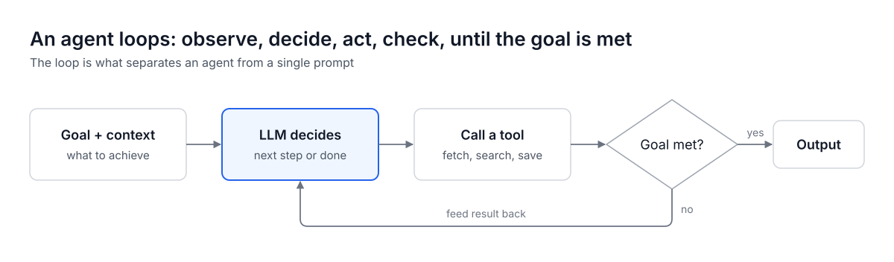
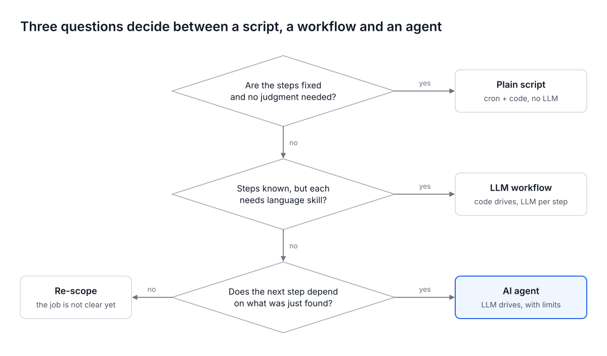
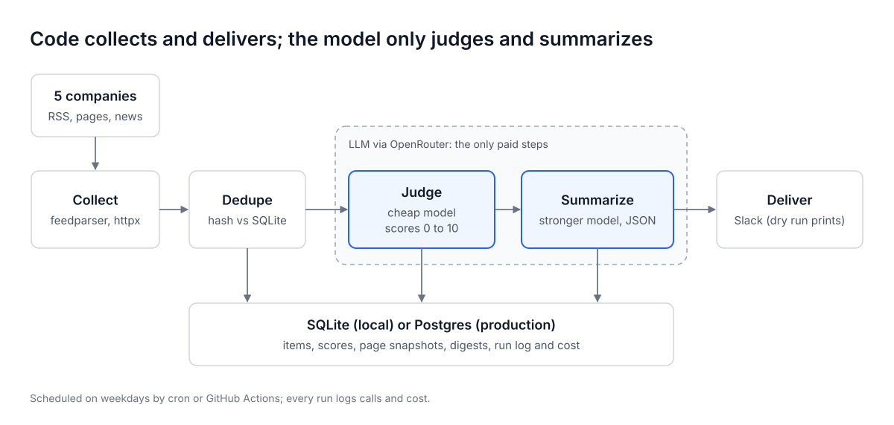
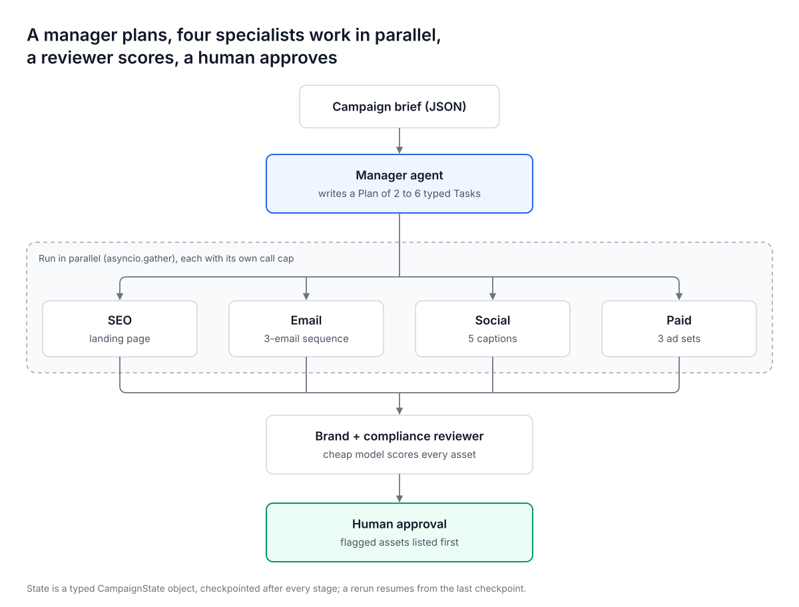
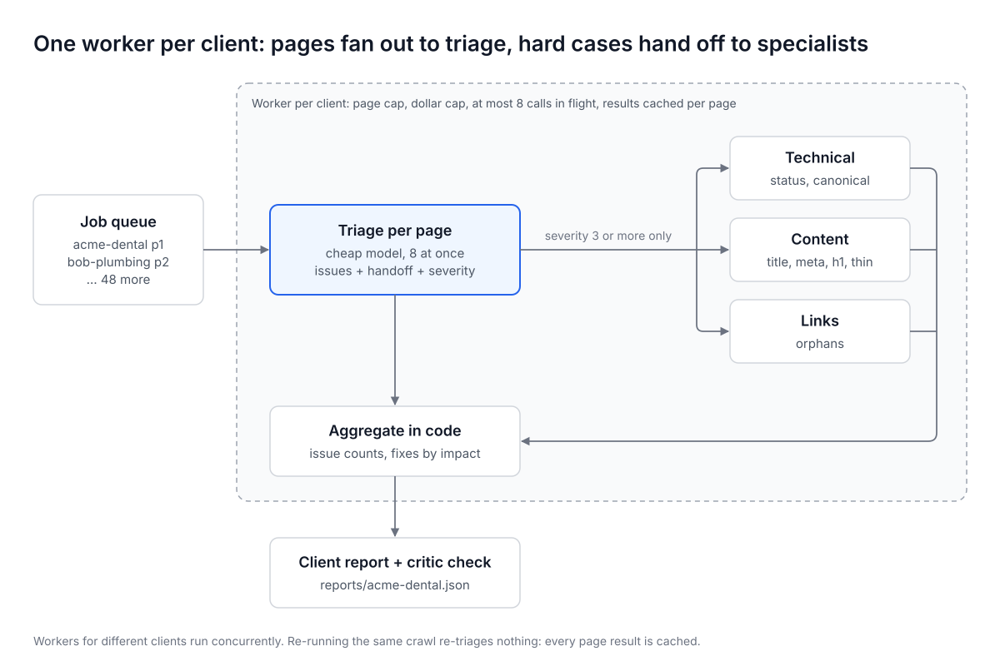

# Marketing AI Agents

Six production-shaped AI agents for marketing teams, from a beginner workflow to a multi-client swarm. One shared model client, hard budget caps on every call, 42 offline tests, and a prompt pack generated from the code.

Companion code for **[The Complete Guide to AI Agents for Marketing: From Zero to Production](https://venkatapagadala.com/guides/ai-agents-for-marketing)**.

```bash
git clone https://github.com/VenkataPagadalaGIT/marketing-ai-agents && cd marketing-ai-agents
python -m venv .venv && source .venv/bin/activate && pip install -r requirements.txt
pytest -q                                         # 42 passed, about 1 second, no network, $0
MOCK_LLM=1 python -m competitor_monitor.main      # prints a sample digest, no API key needed
```



## The six agents

| # | Agent | Level | Pattern it teaches | Try it (offline, $0) |
|---|---|---|---|---|
| 1 | `competitor_monitor` | Beginner | A workflow with two model steps: cheap judge, stronger summarizer. Dedupe, page diffs, budgets, scheduling | `MOCK_LLM=1 python -m competitor_monitor.main` |
| 2 | `review_responder` | Beginner | Prompt chaining, code guardrails, escalation routing, human approval queue | `MOCK_LLM=1 python -m review_responder.agent` |
| 3 | `content_brief` | Medium | Routing plus a real agent loop (ReAct): the model picks the next tool; code enforces step, tool and size limits | `MOCK_LLM=1 python -m content_brief.agent "best crm for small agencies"` |
| 4 | `analytics_narrator` | Medium | Numbers computed in code, evaluator-optimizer loop, grounding check that rejects invented numbers | `MOCK_LLM=1 python -m analytics_narrator.agent` |
| 5 | `campaign_orchestrator` | Complex | Orchestrator-workers, parallel specialists with their own call caps, typed shared state, checkpoints with resume, approval gate | `MOCK_LLM=1 python -m campaign_orchestrator.agent` |
| 6 | `seo_audit_swarm` | Complex | Fan-out and fan-in, routing handoffs, per-client page and dollar caps, concurrent workers, idempotent cache | `MOCK_LLM=1 python -m seo_audit_swarm.agent` |

Only agent 3 is an agent in the strict sense (the model decides what happens next). The others are workflows with model steps, on purpose: if you can write every step down in advance, a workflow is cheaper, faster and easier to test.

## Going live

```bash
cp .env.example .env                                        # add OPENROUTER_API_KEY (and SLACK_WEBHOOK_URL)
python -m competitor_monitor.main --seed                    # once: remember today's posts so day one is not a backlog
DB_PATH=/tmp/scratch.db DRY_RUN=1 python -m competitor_monitor.main   # real models, prints instead of sending
python -m competitor_monitor.main                           # sends the digest to Slack
```

Use a scratch `DB_PATH` for dry runs: anything a run records counts as seen next time.

Before you trust any agent, run it with real models and `DRY_RUN=1` on 20 to 30 real inputs and read every output. That is where you tune the prompts and thresholds, and it costs cents.

## Cost and safety controls

Every model call goes through [`common/llm.py`](common/llm.py), which checks the caps before each attempt, retries included:

| Control | Where | Default |
|---|---|---|
| Run call cap | `MAX_LLM_CALLS_PER_RUN` | 60 (monitor: 40) |
| Run dollar cap, from OpenRouter's reported `usage.cost` | `MAX_COST_USD_PER_RUN` | $0.50 (monitor: $0.10) |
| Per-agent call cap | `LLM(..., agent_call_cap=N)` | orchestrator specialists: 6 each |
| Per-client caps | `TENANTS` in the swarm | pages and dollars per client |
| Kill switch | `AGENT_ENABLED=0` | refuses every model call |
| Fallback models | `FALLBACK_MODELS`, sent as OpenRouter's `models` list | GPT-5 mini, Gemini 3.5 Flash |
| Output contract | Pydantic schema sent to the model and validated; one retry with the error | every call |

Add the outer wall yourself: a credit limit with a reset on the OpenRouter key (one key per agent or per client). The caps in code are the inner wall.

**Estimated model cost per run** at OpenRouter list prices on 2026-10-14 (Claude Haiku 5.5 at $0.10 / $0.50 and Claude Sonnet 5.5 at $2 / $10 per million input / output tokens). Every run prints its real cost.

| Agent | Typical run | Estimated cost |
|---|---|---|
| Competitor monitor | 5 companies, about 30 new items | $0.02 to $0.06 |
| Review responder | 30 reviews | $0.10 to $0.40 |
| Content brief | 1 keyword | $0.02 to $0.05 |
| Analytics narrator | 1 client, 1 to 3 drafts | $0.01 to $0.04 |
| Campaign orchestrator | 1 campaign, 4 channels | $0.06 to $0.15 |
| SEO audit swarm | 1 client, 200 pages | $0.10 to $0.40 |

**Prompt injection.** Every agent reads text it did not write. Prompts say that text is data, and the code removes the dangerous leg of the [lethal trifecta](https://simonwillison.net/2025/Jun/16/the-lethal-trifecta/): no prompt that reads web content also sees keys or private data, and no agent lets the model choose where output goes. The content brief agent only fetches URLs that its own SERP search returned. See [SECURITY.md](SECURITY.md).

## Tests

```bash
pytest -q
MOCK_LLM=1 python scripts/build_prompt_pack.py --check   # the prompt pack matches the code
```

| Layer | Examples | Catches |
|---|---|---|
| Unit | `test_collect_parses_feed`, `test_analysis_is_deterministic`, `test_guardrails_allow_ordinary_phrases` | Parsing bugs, wrong math, guardrail regressions |
| Contract | `test_schema_rejects_bad_llm_output`, `test_grounding_check_rejects_invented_numbers` | A model answer that would corrupt the next step |
| Behavior | `test_step_cap_holds`, `test_budget_stop_keeps_unfinished_items_for_the_next_run`, `test_resume_skips_finished_stages`, `test_fetch_page_only_accepts_urls_from_the_serp`, `test_kill_switch_stops_every_call` | Runaway loops and spend, lost work, unsafe tool use |
| End to end | `test_full_run_dry`, `test_orchestrator_runs_specialists_in_parallel_and_gates` | The pieces not fitting together |

## Layout

```
common/llm.py           one OpenRouter client: schema-checked JSON, cost, caps, kill switch, mock mode
competitor_monitor/     collect, dedupe, diff pages, judge, summarize, deliver, remember
review_responder/       classify, escalate or draft, guardrails, approval queue
content_brief/          route, agent loop over tools, brief, keyword drift check
analytics_narrator/     analyze in code, write, number check, critique, revise
campaign_orchestrator/  plan, specialists in parallel, review, approval bundle, resume
seo_audit_swarm/        per-client worker, parallel triage, specialist handoff, aggregate, critic
prompts/README.md       every production prompt plus 10 reusable prompts for building agents
docs/diagrams/          the architecture diagrams from the guide (SVG)
scripts/                prompt pack generator
```

## Diagrams

| | |
|---|---|
|  |  |
|  |  |

## Read next

The guide's reading list covers the sources this repo stands on. Start with these:
[Anthropic: Building effective agents](https://www.anthropic.com/research/building-effective-agents),
[OpenAI: A practical guide to building agents](https://cdn.openai.com/business-guides-and-resources/a-practical-guide-to-building-agents.pdf),
[ReAct (Yao et al.)](https://arxiv.org/abs/2210.03629),
[Why Do Multi-Agent LLM Systems Fail? (Cemri et al.)](https://arxiv.org/abs/2503.13657),
[12-Factor Agents](https://github.com/humanlayer/12-factor-agents),
[The lethal trifecta](https://simonwillison.net/2025/Jun/16/the-lethal-trifecta/).

## License

MIT. Model ids are strings in `.env`; swap them when newer models appear on OpenRouter.
